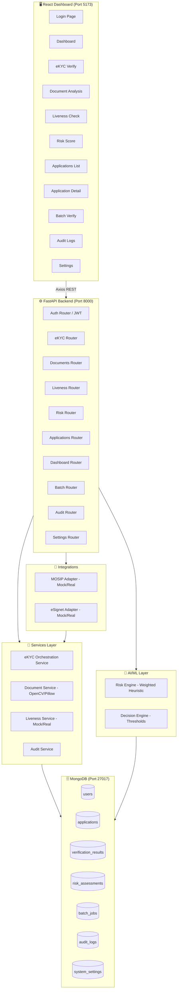
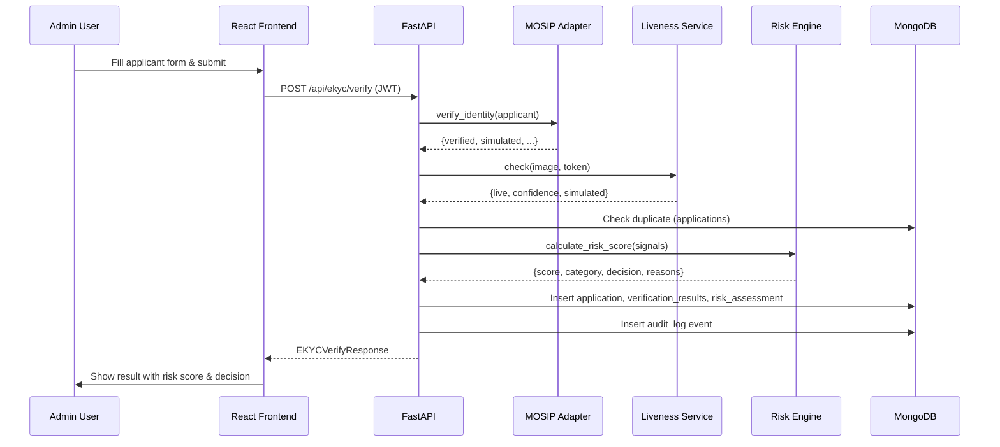
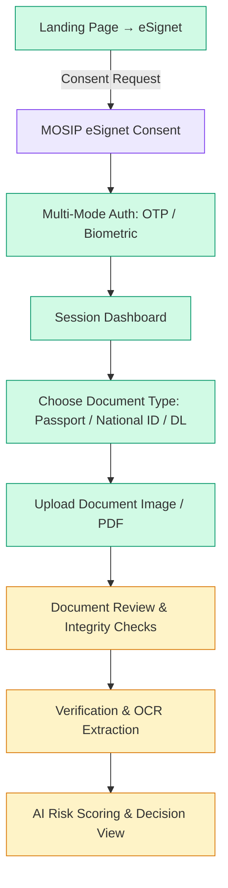

# Architecture Documentation

## System Overview

The eKYC Risk Intelligence platform is a three-tier web application:

1. **Presentation Layer** — React 18 SPA (Vite + Tailwind CSS)
2. **Application Layer** — FastAPI (Python) REST API
3. **Data Layer** — MongoDB Community Server (local)

## Architecture Diagram (Mermaid)



## Data Flow — eKYC Verification



## Database Design & Entity Relationship (Module 1 - Data Layer)

The system data model is designed to support 19 logical entities across MOSIP integration, document & liveness verification, and explainable risk scoring:

```mermaid
erDiagram
    ORGANIZATION ||--o{ RISK_THRESHOLD_CONFIG : configures
    ORGANIZATION ||--o{ BATCH_JOB : initiates
    ORGANIZATION ||--o{ API_CLIENT : issues
    ORGANIZATION ||--o{ VERIFICATION_REQUEST : submits

    APPLICANT ||--o{ VERIFICATION_REQUEST : undergoes
    APPLICANT ||--o{ BEHAVIORAL_SIGNAL : emits
    APPLICANT ||--o{ HISTORICAL_RECORD : maintains

    VERIFICATION_REQUEST ||--o| ESIGNET_SESSION : initiates
    VERIFICATION_REQUEST ||--o| MOSIP_AUTH_RESULT : evaluates
    VERIFICATION_REQUEST ||--o{ DOCUMENT : contains
    VERIFICATION_REQUEST ||--o{ BIOMETRIC_CAPTURE : contains
    VERIFICATION_REQUEST ||--o{ CROSS_REF_RESULT : verifies
    VERIFICATION_REQUEST ||--o| RISK_ASSESSMENT : generates
    VERIFICATION_REQUEST ||--o{ AUDIT_LOG : tracks

    DOCUMENT ||--o| FRAUD_DETECTION_RESULT : yields
    BIOMETRIC_CAPTURE ||--o| LIVENESS_RESULT : yields
    DATA_SOURCE ||--o{ CROSS_REF_RESULT : supplies
    RISK_ASSESSMENT ||--o{ RISK_FACTOR : decomposes

    FRAUD_DETECTION_RESULT ..> RISK_FACTOR : feeds
    LIVENESS_RESULT ..> RISK_FACTOR : feeds
    MOSIP_AUTH_RESULT ..> RISK_FACTOR : feeds
    CROSS_REF_RESULT ..> RISK_FACTOR : feeds
    BEHAVIORAL_SIGNAL ..> RISK_FACTOR : feeds
    HISTORICAL_RECORD ..> RISK_FACTOR : feeds
```

## DigiSetu & MOSIP eSignet Onboarding Flow



## Module Descriptions

### Module 1: Identity Verification (MOSIP Adapter)
- **File**: `app/integrations/mosip/provider.py`
- **MockMosipProvider**: Returns deterministic simulated results based on input hash
- **RealMosipProvider**: Stub — requires MOSIP_BASE_URL + credentials
- **Key design**: Provider interface enables easy swap to real implementation

### Module 2: Document Fraud Detection
- **File**: `app/services/document_service.py`
- **Checks**: File type, size, image dimensions, brightness/contrast, sharpness (Laplacian variance), edge density
- **OCR**: Optional via pytesseract (requires Tesseract binary)
- **Output**: flags[], confidence (0–1), extracted_fields, note

### Module 3: Liveness & Anti-Spoofing
- **File**: `app/services/liveness_service.py`
- **MockLivenessProvider**: Returns simulated live=True with face detection if image uploaded
- **Face detection**: OpenCV Haar cascade (NOT real liveness)
- **Key warning**: Standard face detection ≠ anti-spoofing

### Module 4: eSignet Authentication
- **File**: `app/integrations/esignet/provider.py`
- **MockESignetProvider**: Simulated OIDC authentication
- **RealESignetProvider**: Stub — requires eSignet instance + client registration

### Module 5: AI Risk Scoring Engine
- **File**: `app/ai/risk_engine.py`
- **Approach**: Weighted explainable heuristic model
- **Signals**: 7 configurable weighted signals with zero sensitive attribute bias
- **Output**: score (0–100), category, decision, reasons[], weights_used

### Module 6: Risk Decision Engine
- **Part of**: `app/ai/risk_engine.py`
- **Configurable thresholds**: Read from settings (DB or env vars)
- **Safety**: Simulated providers escalate to MANUAL_REVIEW

### Module 7–10: REST API, Batch, Dashboard, Security
- **All routes**: `app/api/v1/endpoints/`
- **Auth**: JWT Bearer via OAuth2PasswordBearer
- **Roles**: admin (can update decisions), authenticated user (can read/verify)

